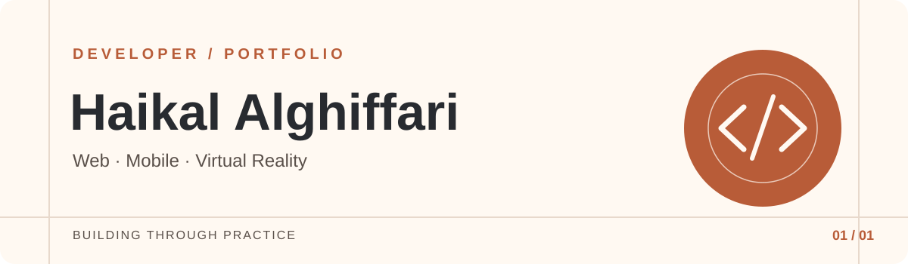

<!-- Profile README for github.com/Haikalalghiffari -->

  

 

### Hi, I'm Haikal.

I build things for the web, mobile devices, and immersive environments. I enjoy working on projects that solve real problems, from community data management to digital public services.

Currently exploring **backend development, MongoDB, and big data** while continuing to build hands-on projects.

[**Browse my repositories**](https://github.com/Haikalalghiffari?tab=repositories) &nbsp;·&nbsp; [**Follow my work**](https://github.com/Haikalalghiffari)

---

### Selected work

| Project | What it is | Stack |
| :-- | :-- | :-- |
| **[DataWarga](https://github.com/Haikalalghiffari/DataWarga)** | Community administration and resident-data web application | `PHP` `Blade` |
| **[Sitara Mobile App](https://github.com/Haikalalghiffari/Sitara-Mobile-App)** | E-government mobile application for a KMIPN competition project | `Dart` |
| **[VR Space Exploration](https://github.com/Haikalalghiffari/vr_space_exploration)** | Space exploration project built for a virtual-reality experience | `C#` `Unity` |
| **[Nusa Rasa](https://github.com/makankacang/Nusa_Rasa)** | Collaborative Android application project | `Kotlin` |
| **[Runneria](https://github.com/makankacang/runneria)** | Collaborative Kotlin application project | `Kotlin` |
| **[Aplikasi Ejimat](https://github.com/Haikalalghiffari/Aplikasi-Ejimat)** | Dart-based mobile application project | `Dart` |

---

### Tools & technologies

**Working with**

**Learning / developing further**

---

### GitHub, at a glance

  

Language statistics summarize repository code, not proficiency. The widget depends on an external service.

---

  <b>MAKE • TEST • IMPROVE</b>
    
  <a href="https://github.com/Haikalalghiffari">github.com/Haikalalghiffari</a>

