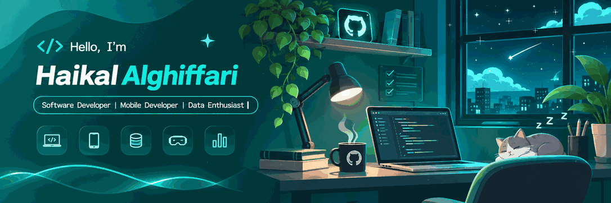

  

  

  
  
  

  <a href="https://github.com/Haikalalghiffari?tab=repositories">Repositories</a> •
  <a href="https://github.com/Haikalalghiffari?tab=stars">Starred</a> •
  <a href="https://github.com/Haikalalghiffari?tab=projects">Projects</a>

---

## About me

I build practical digital solutions across **mobile**, **web**, and **immersive/VR** development.  
I enjoy creating projects that solve real-world problems, from **community data systems** to **public-service applications** and interactive experiences.

- 🔭 Currently building and exploring hands-on software projects
- 🌱 Currently learning **backend development**, **MongoDB**, and **big data**
- 💡 Interested in **mobile apps**, **web apps**, **VR experiences**, and **data-driven systems**
- 🛠️ Working with collaborative student and competition-based projects

> I prefer projects that are useful, simple to use, and meaningful for real users.

---

## Selected projects

| Project | Description | Tech Stack |
|---|---|---|
| [DataWarga](https://github.com/Haikalalghiffari/DataWarga) | Community administration and resident-data web application | `PHP` `Blade` |
| [Sitara Mobile App](https://github.com/Haikalalghiffari/Sitara-Mobile-App) | E-government mobile application for a KMIPN competition project | `Dart` |
| [VR Space Exploration](https://github.com/Haikalalghiffari/vr_space_exploration) | Virtual reality space exploration project | `C#` `Unity` |
| [Nusa Rasa](https://github.com/Haikalalghiffari/makankacang-Nusa_Rasa) | Collaborative Android application project | `Kotlin` |
| [Runneria](https://github.com/Haikalalghiffari/makankacang-runneria) | Collaborative Kotlin-based application project | `Kotlin` |
| [Aplikasi Ejimat](https://github.com/Haikalalghiffari/Aplikasi-Ejimat) | Dart-based mobile application project | `Dart` |

---

## Tech stack

### Working with

  
  
  
  
  
  
  
  

### Learning

  
  
  
  
  
  

---

## GitHub stats

  
  

  

  

---

## A little note

Thanks for visiting my profile.  
I'm still learning, building, and improving step by step — and every project is part of that journey.

  

